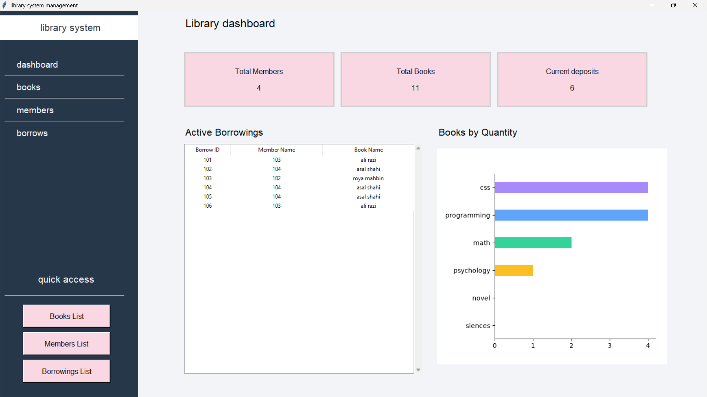
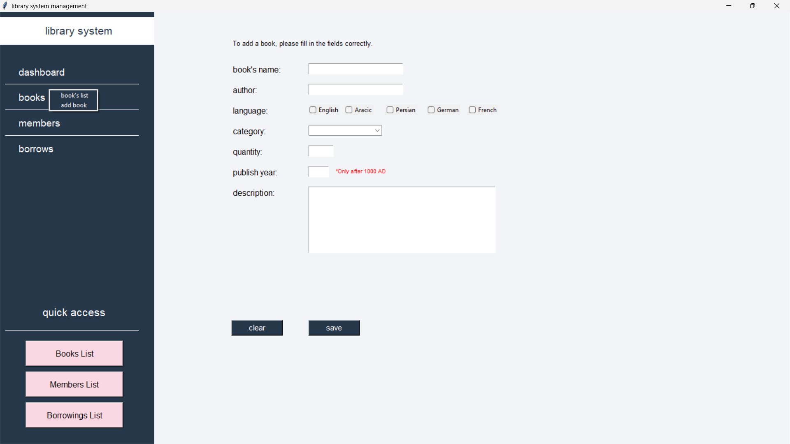
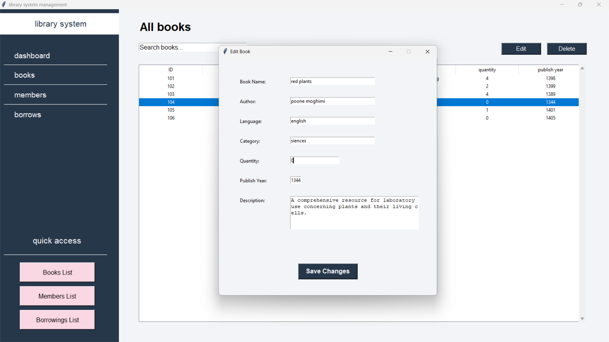
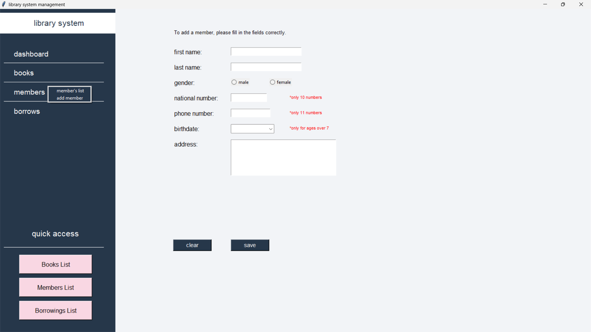
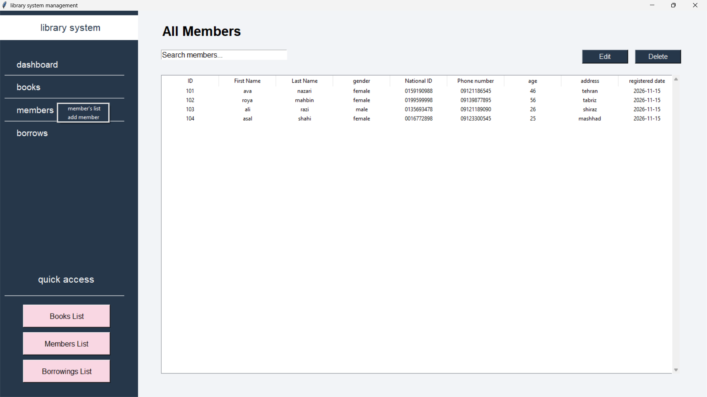
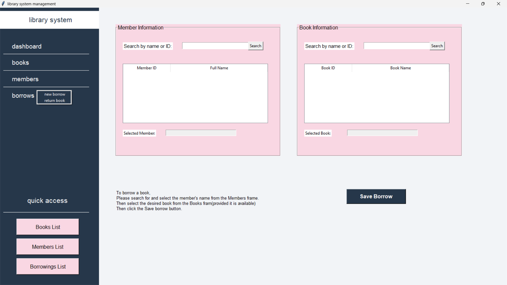
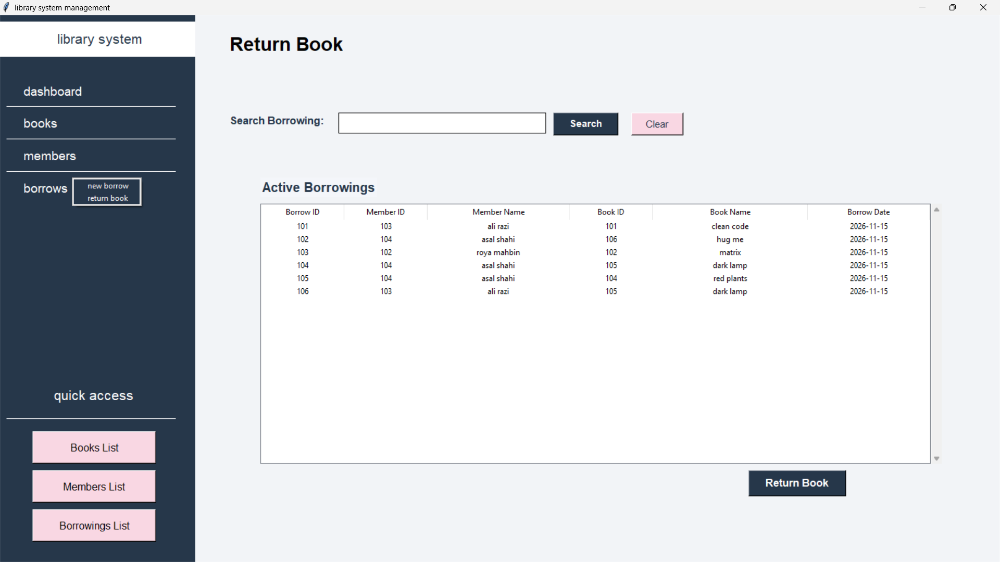

# 📚 Library Management System

A desktop-based Library Management System developed using **Python, Tkinter, and Microsoft SQL Server**.

This application helps manage library operations, including books, members, borrowing transactions, and returns through a user-friendly graphical interface.

## 📸 Screenshots

### Dashboard
<p align="center">
  
</p>

### Books Management
<p align="center">
  
  
</p>

### Members Management
<p align="center">
  
  
</p>

### Borrowing & Returns
<p align="center">
  
  
</p>

## ✨ Features

- **Dashboard:** Display library statistics and data visualizations.
- **Book & Member Management:** Add,Register, edit, delete, search and manage them.
- **Borrowing & Returns:** Record borrowing transactions and manage book returns.
- **Database Management:** Store and manage library data using SQL Server.

## 🛠️ Technologies Used

- Python
- Tkinter
- Microsoft SQL Server
- PyODBC
- Pandas
- Matplotlib

## 🗄️ Database Structure & Scripts

The database includes three main tables: `books`, `members`, and `borrowings`.

The `Database` folder contains three SQL scripts:

- `create_tables.sql`
- `values.sql`
- `queries.sql`

These scripts are used to create, populate, and manage the database.
## ⚙️ Installation & Setup

**Prerequisites:**
- Python 3.12
- Microsoft SQL Server
- ODBC Driver 18 for SQL Server

**Steps:**


## ⚙️ Installation & Setup

**Prerequisites:**
- Python 3.12
- Microsoft SQL Server
- ODBC Driver 18 for SQL Server

**Steps:**

1. Clone the repository:

```bash
git clone https://github.com/melinaabolhassani/Library-Management-System.git
```

2. Install the required libraries:

```bash
pip install -r requirements.txt
```

3. Set up the database using one of the following methods:

- **Option 1 – Restore Backup:** Download the `.bak` file from Releases and restore it using SSMS.
- **Option 2 – Run SQL Scripts:** Execute the three SQL scripts in the `Database` folder using SSMS.


4. Configure the database connection in `dbconnect.py`.

5. Run the application:

```bash
python main.py
```

## 📁 Project Structure

```text
Library-Management-System/
│
├── main.py
├── pages.py
├── funcs.py
├── dbconnect.py
├── README.md
├── requirements.txt
│
├── Database/
│   ├── create_tables.sql
│   ├── values.sql
│   └── queries.sql
│
└── Screenshots/
```

## 👩‍💻 Author

**Melina Abolhassani**

- GitHub: [YOUR-GITHUB-USERNAME](https://github.com/melinaabolhassani)
- LinkedIn: [LinkedIn Profile](https://www.linkedin.com/in/melinaabolhassani/)

---

*Developed as a Python desktop application project.*